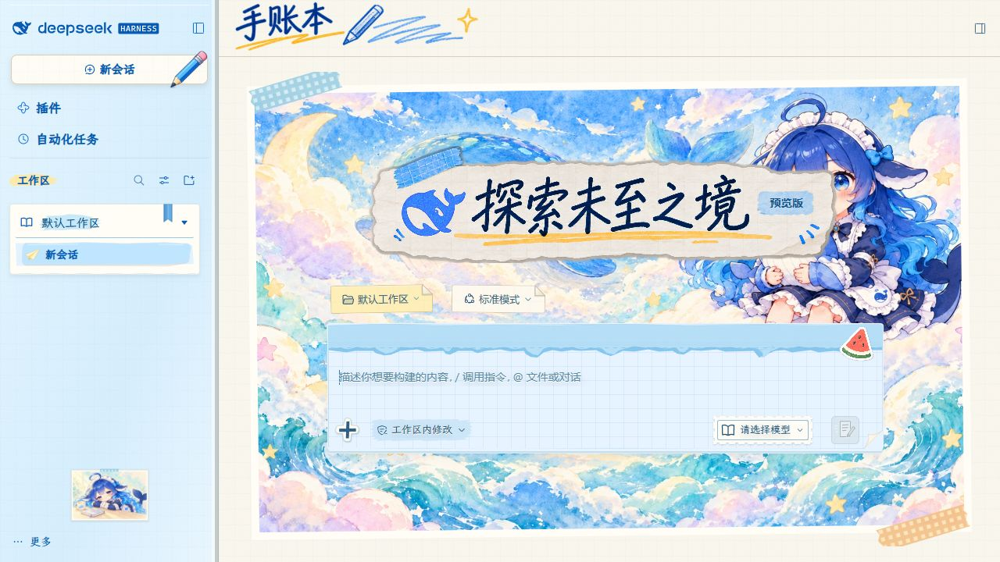

# DIY Journal: skin and style menu

English | [中文](README.zh.md)

A standard DSH bundle containing DIY Journal skin 1.14.2 and its local editor.
First load provisions the skin. Use **Settings > DIY Journal** to apply it and
edit photos, layouts, rotation, scale, tape, borders and captions.

[Download plugin 1.1.0](https://github.com/Alphazerolan/diy-journal-settings/releases/tag/v1.1.0) ·
[Standalone skin and component gallery](https://github.com/Alphazerolan/diy-journal-skin) ·
[Changelog](CHANGELOG.md)

This repository upgrades the former standalone editor into a skin-and-editor
bundle. It edits DIY Journal only, not arbitrary skins. The standalone skin
remains available for users who only need its appearance.



## Requirements

- DSH 0.2.1-rc.2 or newer, with skin-center installed and enabled.
- Verified on Windows. The editor needs Python 3.9+ (standard library only).
  The skin still works without Python.
- Distributed through GitHub Releases; not yet published to npm or listed in Workshop.

## Install

Download the `.tgz` from the link above and install it with the standard plugin manager:

```powershell
dsh plugin --profile desktop add "C:/Downloads/alphazerolan-dsh-plugin-diy-journal-1.1.0.tgz"
```

Use `web` instead of `desktop` for Web profiles. Fully restart that DSH instance.
Use **Settings > DIY Journal > Apply Journal**, or choose it in skin-center.
Apply persists the selection and reloads the page. No CMD or Python installer
needs to be run. Python is detected automatically; `DIY_JOURNAL_PYTHON` can
specify an absolute executable path.

The plugin carries the skin assets; skin-center continues to render them.
A delegated-skin registration is not required.

## Migrate from the old local editor

If the old entry was installed with `python install.py`, run
`python install.py --uninstall` from that directory before installing this bundle
and restarting. Do not load both entries. Personal data and the skin are retained.

## Data, updates and disabling

- Skin: `$DSH_HOME/skins/diy-journal`; respects `DSH_SKINS_HOME` / `DSH_SKINS_DIR`.
- Photos/layouts: `$DSH_HOME/diy-journal-editor`, outside the plugin package.
- First editor launch extracts defaults; subsequent launches preserve photos,
  layouts and explicit empty selections.
- Updates replace only files matching previous shipped defaults. Local edits
  are preserved and reported. Previous files are backed up under
  `$DSH_HOME/diy-journal-editor-backups`.
- Existing manual installs are adopted conservatively: unknown differences
  stay unchanged. Preserved files do not receive upstream changes to those files.
- Saving only updates DIY Journal; it never selects it over another active skin.
- Switching away cleans the plugin's state markers; switching back mounts them.
- Disabling/uninstalling closes the menu and enhancements, retaining the asset
  skin and personal data. Select another skin or **Use official default** first
  to also remove its appearance.

The menu is loopback-only, with random tokens, origin checks and a 20-minute
idle timeout. Photos are never uploaded.

## Development

```sh
npm run build
npm test
python tests/test_install.py
npm pack
```

`client.js` is generated from `src/` and the bundled state projector. Asset-skin
provenance checks stay intact. Only code shipped in this plugin is executed,
never arbitrary scripts from the user's skin directory.
Code is MIT; asset terms are in [NOTICE](NOTICE) and [skin/NOTICE](skin/NOTICE).
