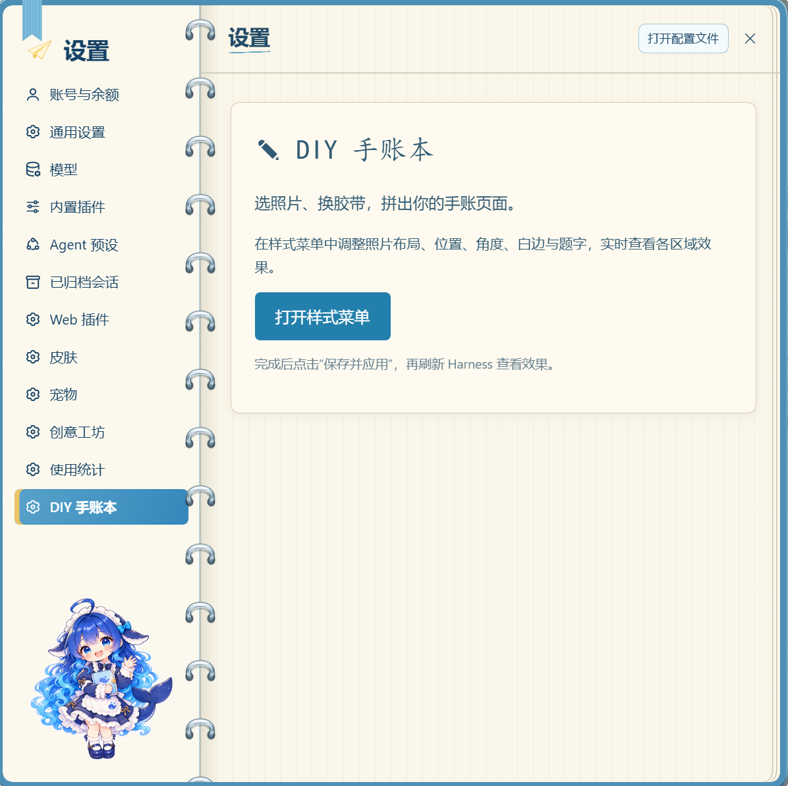
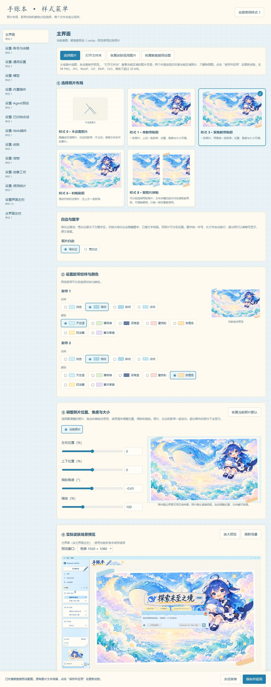
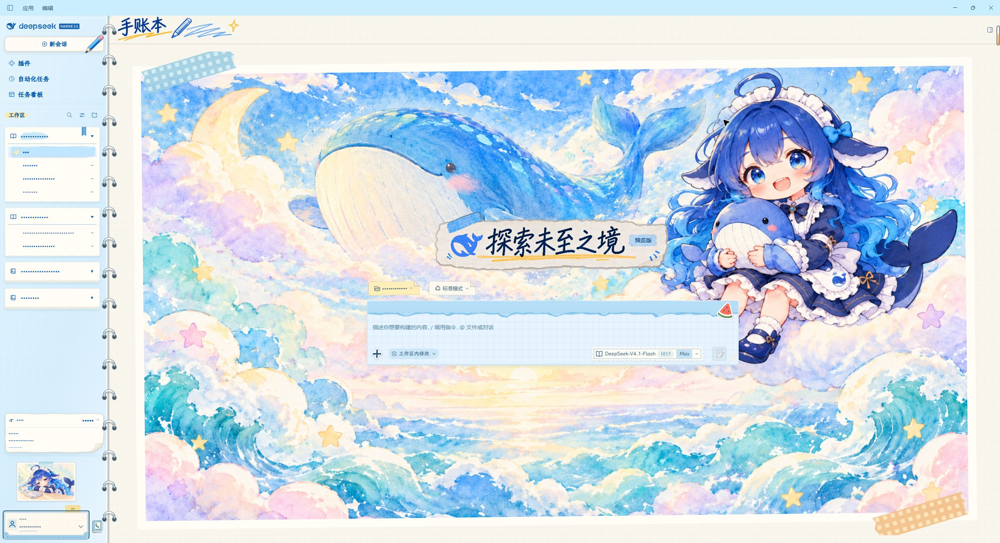
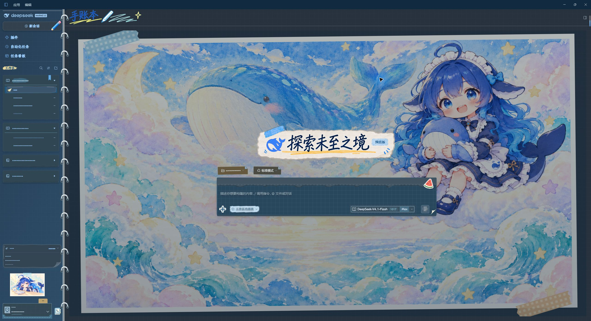
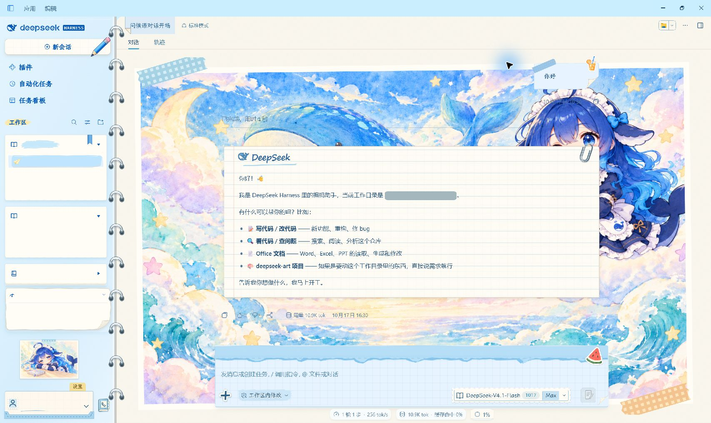
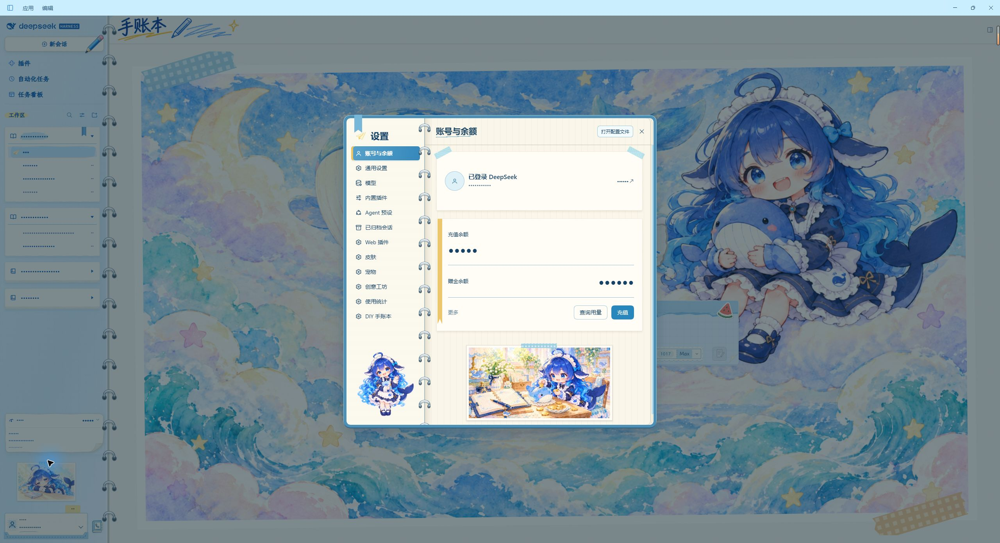

# DIY 手账本：皮肤与样式菜单

[English](README.md) | 中文

本皮肤以手账本为主题，为 DeepSeek Harness（DSH）重绘了开发者尽可能想到的界面组件，从主界面、侧栏、对话气泡，到菜单、卡片和工具面板，让日常使用也有翻阅手账的感觉。[查看效果预览](#效果预览)。

为了贴合手账本自由拼贴的特性，本插件将 **DIY 手账本皮肤 1.14.3 与样式菜单** 放在同一个安装包中。你可以在 **设置 → DIY 手账本** 应用皮肤、打开菜单，调整各个位置的布局与样式、更换图片，搭配胶带、白边和题字，组装属于自己的手账本。

[下载插件 1.1.2](https://github.com/Alphazerolan/diy-journal-settings/releases/tag/v1.1.2) ·
[纯皮肤版本与组件展示](https://github.com/Alphazerolan/diy-journal-skin) ·
[更新记录](CHANGELOG.md)

本仓库由原来的独立样式菜单升级为一体化插件。仅调整 DIY 手账本，
不是适用于所有皮肤的通用编辑器。只需要外观时，可以继续使用纯皮肤版本。

## 皮肤与 DIY 功能

- **纸张与手绘风格：** 手写标题、纸页与活页装订、胶带拼贴，以及浅色／深色配色；内置 14 张不同主题的 ChatGPT 生成鲸鱼娘配图。
- **专门设计的组件：** 用户便签与回复信纸、会话小飞机、通知信封及展开状态、折叠会话、工作区悬浮信息、任务看板、个人账户卡签、电话簿式远程访问窗口等。[按功能查看组件静态预览](https://github.com/Alphazerolan/diy-journal-skin/blob/main/docs/COMPONENTS.md)。
- **按区域自由拼贴：** 主界面、侧栏和设置各页独立选择照片与布局，支持移动、倾斜、缩放、胶带颜色与纹样、宽窄白边及题字。
- **双照片与空图样式：** 调换两张照片的顺序及遮挡关系；不设置照片时收起图片区，不留空白占位。
- **场景预览：** 在菜单中查看对应主界面或设置区域的效果，保存后刷新 DSH 应用。自选照片保存在本机。

## 样式菜单

在 **设置 → DIY 手账本** 中打开样式菜单。



- **打开文件夹：** 打开当前区域的图片目录，不改变当前选图。添加图片后可通过“选择图片”选用。
- **恢复皮肤现用图片：** 从已安装的 DIY 手账本中读取当前区域正在使用的照片，恢复到菜单预览。
- **恢复鲸鱼娘预设图：** 恢复随插件附带、效果图中展示的对应区域鲸鱼娘配图。

两个恢复按钮只作用于当前区域，保留已有图片文件和布局参数；当前选择“不设置照片”时，恢复有图会启用单胶带布局以显示预览。**点击“保存并应用”后才更新皮肤**，随后刷新 DSH 查看。

下图为更新后的样式菜单实际运行截图；菜单底部的皮肤场景使用静态示例内容。



## 效果预览

以下为皮肤仓库已有的 DSH 实际窗口截图，沿用该仓库的脱敏展示；展示内置皮肤外观，布局可能随 DSH 版本、窗口大小及内容变化。更多专门设计的组件见[组件静态预览](https://github.com/Alphazerolan/diy-journal-skin/blob/main/docs/COMPONENTS.md)。

### 主界面 · 浅色



### 主界面 · 深色



### 对话气泡 · 用户与 DeepSeek 回复

用户消息采用蓝色方格便签，DeepSeek 回复采用带手写署名与回形针的横线信纸。截图保留完整侧栏；个人信息已隐藏，浅色与深色均在应用中切换后拍摄。

**浅色**



**深色**


### 设置 · 浅色



### 设置 · 深色


## 环境要求

- DSH 0.2.1-rc.2 或更新版本，已安装并启用皮肤中心。
- Windows 已验证。菜单需要 Python 3.9+，只使用标准库；没有 Python 时皮肤仍可使用。
- 通过 GitHub Releases 提供安装包；尚未发布 npm 或登记工坊。

## 安装

从上方下载入口取得 `.tgz` 文件，再通过标准插件管理方式安装，例如桌面档案：

```powershell
dsh plugin --profile desktop add "C:/Downloads/alphazerolan-dsh-plugin-diy-journal-1.1.2.tgz"
```

Web 用户将 `desktop` 换成 `web`。完全退出并重启对应 DSH 实例，打开
**设置 → DIY 手账本 → 应用手账本**。应用按钮保存选择并刷新页面；
也可在皮肤中心切换。无需运行 CMD 或 Python 安装脚本。
Python 自动检测，特殊环境可设置 `DIY_JOURNAL_PYTHON` 为其绝对路径。

本插件自带皮肤资产，渲染沿用皮肤中心，不需要委托皮肤登记。

## 旧版迁移

如果以前运行过 `python install.py` 安装本地入口，先在旧插件目录运行
`python install.py --uninstall`，再安装本包并重启。不要同时加载两个入口。
这只移除旧入口，保留照片、布局及皮肤。

## 数据、更新与停用

- 皮肤默认在 `$DSH_HOME/skins/diy-journal`，尊重 `DSH_SKINS_HOME` / `DSH_SKINS_DIR`。
- 照片与布局在 `$DSH_HOME/diy-journal-editor`，不放在插件安装目录。
- 首次打开菜单提取预设插画；以后保留自选照片、布局和明确的空图选择。
- 更新只替换仍与旧版预设一致的皮肤文件；本地定制保留并提示。
  原文件备份至 `$DSH_HOME/diy-journal-editor-backups`。
- 对原有手工安装的皮肤保守接入，不能确认来源的差异不覆盖。
  被保留的定制文件也不会自动获得新版对同一文件的改进。
- 检测到本地定制或额外文件时，保留可能仍被引用的旧素材，因此已有定制安装的占用可能大于全新安装。
- 菜单保存只更新 DIY 手账本，不会切走正在使用的其他皮肤。
- 切走皮肤清理插件动态标记，切回重新挂载。
- 停用或卸载插件关闭菜单服务及附加效果，保留资产皮肤与个人数据。
  要同时停用外观，先选择其他皮肤或点击“使用官方默认”。

菜单仅监听本机，具有随机令牌、来源检查和 20 分钟空闲退出，不上传照片。

## 素材与角色声明

默认 14 张配图由 ChatGPT 生成，逐图主题与记录见 [ARTWORK.json](skin/ARTWORK.json)。使用的角色为 **DeepSeek 鲸鱼娘（大肥鱼）/ Whale-chan**：原始角色设计署名 [上善](https://www.pixiv.net/users/62155430)，DeepSeek 女仆再设计署名 [ZipZipPipe](https://www.pixiv.net/users/18604994)，本皮肤插画生成、手账布局与适配由 Alphazerolan 完成。详细来源与范围见 [NOTICE](skin/NOTICE)。

本项目为非官方二创，角色再分发授权尚未独立核实；AI 生成不代表已取得角色授权。随附插画及角色画面仅限个人非商业使用，第三方权利仍归相应权利人。字体保留各自 OFL 授权，代码采用 [MIT](LICENSE)。

## 开发

```sh
npm run build
npm test
npm run test:python
npm pack
```

`client.js` 从 `src/` 和随包状态投影逻辑生成。原皮肤来源审查机制保持不变；
插件只运行随插件发布的代码，不加载用户皮肤目录中的任意脚本。
代码 MIT；素材条款见 [NOTICE](NOTICE) 和 [皮肤声明](skin/NOTICE)。
